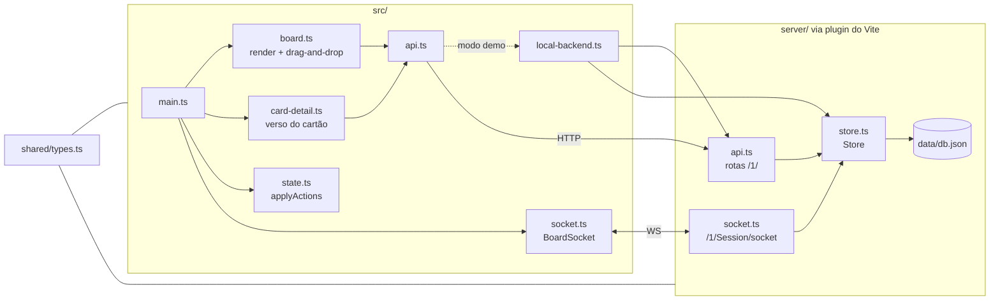

# Uaillo

[](https://github.com/theLASTofG/Uaillo/actions/workflows/pages.yml)

Quadro Kanban no estilo do Trello, com tema medieval em pixel art (mural de guilda numa masmorra à noite). Foi feito a partir de engenharia reversa do cliente web do Trello (REST + socket com `reqid` + arrastar-e-soltar nativo) e da documentação pública da API.

- **Demo:** https://thelastofg.github.io/Uaillo/
- **Mapa do repositório (graphify, atualizado a cada push):** https://thelastofg.github.io/Uaillo/graph/
- **Relatório do mapa:** https://thelastofg.github.io/Uaillo/graph/GRAPH_REPORT.md

## Funcionalidades

- Listas e cartões com arrastar-e-soltar nativo (`dragstart`/`dragover`/`drop`), posições fracionárias como no Trello (`pos`, passo 65535).
- Verso do cartão: título, descrição, etiquetas (6 cores padrão), prazo com "concluído", checklists com barra de progresso e comentários.
- Selos na frente do cartão: prazo (vencido, vence em 24 h, concluído), descrição, checklist e comentários.
- Filtro de cartões por nome ou etiqueta.
- Sincronização em tempo real entre abas: carga inicial por REST, mudanças chegam como ações (`updateModels`) pelo socket, com ressincronização por `ixLastUpdate` ao reconectar.

## Três modos

| | Local (`npm run dev`) | Online compartilhado (Render) | GitHub Pages sem backend (demo) |
|---|---|---|---|
| Backend | API REST + WebSocket no dev server do Vite | `server/standalone.ts` (mesma API e socket) | As mesmas rotas e o mesmo `Store`, no navegador |
| Dados | `data/db.json` | `data/db.json` no servidor (volta ao quadro inicial quando o Render reinicia) | `localStorage` de cada visitante |
| Tempo real | Entre todos os clientes conectados | Entre todos que abrirem o site | Entre abas do mesmo navegador |

O Pages usa o backend online quando a variável `UAILLO_API_URL` existe no repositório; sem ela, cai no modo demo.

## Backend online (endpoint)

1. No [Render](https://render.com), **New → Blueprint** e escolha este repositório. O [`render.yaml`](render.yaml) cria o serviço `uaillo` (plano gratuito, com WebSocket).
2. Quando subir, copie a URL (ex.: `https://uaillo.onrender.com`). Ela já serve o app inteiro, e a API fica em `/1/…` com o socket em `/1/Session/socket`.
3. Em **Settings → Secrets and variables → Actions → Variables**, crie `UAILLO_API_URL` com essa URL e rode o workflow `Pages` de novo. O site do Pages passa a usar o quadro compartilhado.

Variáveis do servidor: `PORT`, `ALLOWED_ORIGINS` (origens liberadas para CORS e socket, separadas por vírgula; o próprio host sempre é aceito) e `DATA_FILE` (caminho do banco). Corpo de requisição limitado a 256 KB. A API não tem login: qualquer pessoa com o link pode editar o quadro.

No plano gratuito o serviço dorme após 15 minutos sem uso; a primeira visita depois disso demora ~1 minuto e o socket reconecta sozinho.

## Rodar localmente

```bash
npm install
npm run dev
```

Abre em http://localhost:5180. Outros comandos:

- `npm run build:pages`: site estático do Pages em `dist/` (com `VITE_API_URL` aponta para um backend).
- `npm run build && npm start`: servidor de produção em http://localhost:8080.
- `npm run theme`: regera `src/style.css` a partir de [`tools/gen-theme.py`](tools/gen-theme.py).

## Tema medieval pixel art

As regras de direção de arte (paleta, grade de pixels, molduras 9-slice, ícones, animações em `steps()`, checklist de entrega) estão na skill [`.claude/skills/medieval-pixel-art`](.claude/skills/medieval-pixel-art/SKILL.md), que o Claude Code carrega ao mexer no visual. Os SVGs do tema (cenário noturno, pedra, tochas, cursores, molduras) são gerados por `tools/gen-theme.py`; não edite os data-URIs do CSS à mão.

## Arquitetura



### API (formato da API pública do Trello, prefixo `/1/`)

| Método | Rota | O que faz |
|---|---|---|
| GET | `/1/members/me/boards` | Quadros |
| GET | `/1/boards/:id` | Quadro com etiquetas, listas e cartões |
| POST / PUT / DELETE | `/1/cards`, `/1/cards/:id` | Cartões (`name`, `desc`, `idList`, `pos`, `closed`, `idLabels`, `due`, `dueComplete`) |
| POST / PUT | `/1/lists`, `/1/lists/:id` | Listas |
| POST | `/1/cards/:id/checklists` | Nova checklist |
| DELETE | `/1/checklists/:id` | Remove checklist |
| POST | `/1/checklists/:id/checkItems` | Novo item |
| PUT / DELETE | `/1/cards/:id/checkItem/:idItem` | Marca (`state`) ou remove item |
| GET / POST | `/1/cards/:id/actions`, `/1/cards/:id/actions/comments` | Comentários (`commentCard`) |

## Mapa do repositório (graphify)

O workflow [`pages.yml`](.github/workflows/pages.yml) roda o [graphify](https://github.com/safishamsi/graphify) a cada push na `main`. Ele extrai a estrutura do código por AST (sem LLM e sem chave de API), agrupa os módulos em comunidades e publica:

- [`/graph/`](https://thelastofg.github.io/Uaillo/graph/): grafo interativo para navegar pelos arquivos, funções e tipos;
- [`/graph/GRAPH_REPORT.md`](https://thelastofg.github.io/Uaillo/graph/GRAPH_REPORT.md): módulos mais conectados, conexões entre comunidades e perguntas sugeridas.

Na nuvem os nomes das comunidades ficam genéricos (`Community N`), porque nomeá-las precisa de LLM. Localmente, `/graphify --update` no Claude Code gera o mapa completo, incluindo os documentos.

## Engenharia reversa

O resumo do que foi observado, inferido e deixado em aberto está em [`trello-engenharia-reversa.md`](trello-engenharia-reversa.md).
