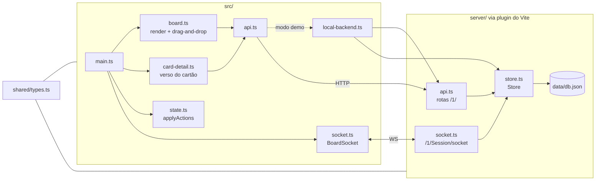

# Uaillo

[](https://github.com/OWNER/REPO/actions/workflows/pages.yml)

Quadro Kanban no estilo do Trello, com tema medieval em pixel art (mural de guilda numa masmorra à noite). Foi feito a partir de engenharia reversa do cliente web do Trello (REST + socket com `reqid` + arrastar-e-soltar nativo) e da documentação pública da API.

- **Demo:** https://OWNER.github.io/REPO/
- **Mapa do repositório (graphify, atualizado a cada push):** https://OWNER.github.io/REPO/graph/
- **Relatório do mapa:** https://OWNER.github.io/REPO/graph/GRAPH_REPORT.md

## Funcionalidades

- Listas e cartões com arrastar-e-soltar nativo (`dragstart`/`dragover`/`drop`), posições fracionárias como no Trello (`pos`, passo 65535).
- Verso do cartão: título, descrição, etiquetas (6 cores padrão), prazo com "concluído", checklists com barra de progresso e comentários.
- Selos na frente do cartão: prazo (vencido, vence em 24 h, concluído), descrição, checklist e comentários.
- Filtro de cartões por nome ou etiqueta.
- Sincronização em tempo real entre abas: carga inicial por REST, mudanças chegam como ações (`updateModels`) pelo socket, com ressincronização por `ixLastUpdate` ao reconectar.

## Dois modos

| | Local (`npm run dev`) | GitHub Pages (demo) |
|---|---|---|
| Backend | API REST + WebSocket dentro do dev server do Vite | As mesmas rotas e o mesmo `Store`, rodando no navegador |
| Dados | `data/db.json` | `localStorage` de cada visitante |
| Tempo real | Entre todos os clientes conectados | Entre abas do mesmo navegador (evento `storage`) |

## Rodar localmente

```bash
npm install
npm run dev
```

Abre em http://localhost:5180. Para gerar o site estático do Pages: `npm run build:pages` (saída em `dist/`).

## Arquitetura



### API (formato da API pública do Trello, prefixo `/1/`)

| Método | Rota | O que faz |
|---|---|---|
| GET | `/1/members/me/boards` | Quadros |
| GET | `/1/boards/:id` | Quadro com etiquetas, listas e cartões |
| POST / PUT / DELETE | `/1/cards`, `/1/cards/:id` | Cartões (`name`, `desc`, `idList`, `pos`, `closed`, `idLabels`, `due`, `dueComplete`) |
| POST / PUT | `/1/lists`, `/1/lists/:id` | Listas |
| POST | `/1/cards/:id/checklists` | Nova checklist |
| DELETE | `/1/checklists/:id` | Remove checklist |
| POST | `/1/checklists/:id/checkItems` | Novo item |
| PUT / DELETE | `/1/cards/:id/checkItem/:idItem` | Marca (`state`) ou remove item |
| GET / POST | `/1/cards/:id/actions`, `/1/cards/:id/actions/comments` | Comentários (`commentCard`) |

## Mapa do repositório (graphify)

O workflow [`pages.yml`](.github/workflows/pages.yml) roda o [graphify](https://github.com/safishamsi/graphify) a cada push na `main`. Ele extrai a estrutura do código por AST (sem LLM e sem chave de API), agrupa os módulos em comunidades e publica:

- [`/graph/`](https://OWNER.github.io/REPO/graph/): grafo interativo para navegar pelos arquivos, funções e tipos;
- [`/graph/GRAPH_REPORT.md`](https://OWNER.github.io/REPO/graph/GRAPH_REPORT.md): módulos mais conectados, conexões entre comunidades e perguntas sugeridas.

Na nuvem os nomes das comunidades ficam genéricos (`Community N`), porque nomeá-las precisa de LLM. Localmente, `/graphify --update` no Claude Code gera o mapa completo, incluindo os documentos.

## Engenharia reversa

O resumo do que foi observado, inferido e deixado em aberto está em [`trello-engenharia-reversa.md`](trello-engenharia-reversa.md).
